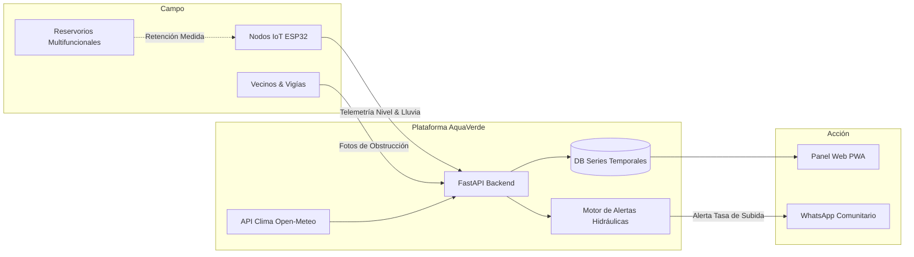

# 🌿 AquaVerde — Reto 05 (Rally Latinoamericano de Innovación 2026)

> **"Monitoreo Inteligente e Infraestructura Verde en Reservorios Pluviales."**  
> Solución integral que une telemetría IoT de bajo costo, reservorios multifuncionales adaptativos según el clima, red comunitaria de vigías y reportes ciudadanos de drenaje.

---

## 🎯 Reto y Propósito

En comunidades vulnerables de Managua y Latinoamérica, los reservorios y cauces urbanos se desbordan intempestivamente provocando anegaciones graves. La mayoría de soluciones fallan porque solo alertan cuando el nivel ya es crítico o no contemplan el uso multifuncional del suelo.

**AquaVerde** aborda este desafío integrando:
- 📡 **Nodos IoT ESP32 + Telemetría en Tiempo Real**: Nodos autónomos con sensor ultrasónico, pluviómetro, batería solar y alertas por tasa de subida.
- 🌿 **Infraestructura Verde y Reservorios Multifuncionales**: Espacios adaptativos según las condiciones climáticas (parques y canchas deportivas en época seca; retención, amortiguamiento y aliviaderos de emergencia en temporada lluviosa).
- 📢 **Red Comunitaria de Vigías Barriales**: Notificaciones tempranas y alertas por WhatsApp para evacuación preventiva.
- 📸 **Participación Ciudadana y Foro Vecinal**: Reporte vecinal con fotografías y mapeo satelital de incidencias de drenaje.

---

## 🏛️ Arquitectura del Sistema



---

## 🛠️ Stack Tecnológico

- **Backend**: Python 3.11+ / FastAPI (REST API asíncrona de alto desempeño)
- **Base de Datos**: PostgreSQL / TimescaleDB (relacional + series temporales)
- **Frontend / PWA**: React 18, Vite, Tailwind CSS, Leaflet.js
- **Modelos de IA**: Scikit-Learn (Pronóstico hidrológico 1-3h) + YOLOv8/OpenCV (Detección de obstrucción en drenajes)
- **Mensajería**: Twilio / Whapi (WhatsApp y SMS)
- **Firmware IoT**: ESP32 (MicroPython / C++) con sensor ultrasónico impermeable y pluviómetro
- **Contenedores**: Docker & Docker Compose

---

## 📂 Estructura del Repositorio

```
Rally_2026/
├── backend/                  # Código fuente de la API REST (FastAPI)
├── frontend/                 # Aplicación web interactiva y mapa (React)
├── docs/
│   ├── api/
│   │   └── openapi.yaml      # Contrato OpenAPI 3.0.3 interactivo y completo
│   └── architecture/
│       └── STACK.md          # Arquitectura detallada y división de trabajo
├── infra/                    # Dockerfile y docker-compose.yml
└── README.md
```

---

## 📋 Contrato de APIs

El contrato OpenAPI 3.0 completo se encuentra documentado en:
👉 [`docs/api/openapi.yaml`](file:///home/jonathan/Documents/Rally_2026/docs/api/openapi.yaml)

Cubre todos los endpoints necesarios para:
- Ingesta de telemetría IoT (`POST /api/v1/telemetry/readings`)
- Consulta de tasa de subida rápida (`GET /api/v1/nodes/{id}/rate`)
- Aprobación humana de alerta roja (`POST /api/v1/alerts/{id}/approve`)
- Red de vigías y difusión comunitaria (`/api/v1/community/*`)
- Medición de impacto de infraestructura verde (`/api/v1/green-infrastructure/*`)
- Pronóstico con IA a 1-3 horas (`/api/v1/forecast/predict`)
- Reporte fotográfico con clasificación por Visión AI (`POST /api/v1/reports/incidents`)
- Simulador de lluvia torrencial para jurado (`POST /api/v1/simulator/run`)

---

## 👥 Equipo Multidisciplinario

| Integrante / Disciplina | Enfoque en el Proyecto |
|---|---|
| **Computación 1 (Backend)** | API REST en FastAPI, persistencia y motor de reglas de tasa de subida |
| **Computación 2 (Frontend)** | Dashboard web PWA, mapas interactivos con Leaflet y consola de alertas |
| **Computación 3 (IA & Datos)** | Modelo de pronóstico a 1-3h (C), visión artificial de reportes (E) y simulador |
| **Sistemas** | Procesos de escalamiento, matriz de trazabilidad, roles y protocolo comunitario (D) |
| **Electrónica** | Esquema del nodo ESP32, sensor ultrasónico impermeable, calibración y LoRa/GSM (A) |
| **Arquitectura** | Diseño espacial de jardines de lluvia y zonas de retención con renders antes/después (B) |
