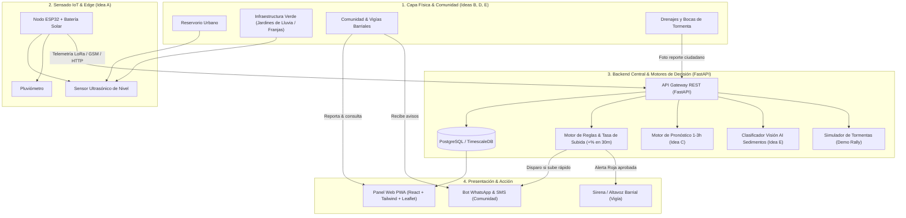

# 🏗️ Arquitectura y Stack Tecnológico - Reservorio Vivo

> **Rally Latinoamericano de Innovación 2026** — *Reto 05: Monitoreo Inteligente e Infraestructura Verde*  
> **Enfoque Integrado**: Unión de Ideas A + B + C + D + E

---

## 1. Justificación y Selección del Stack

| Capa / Módulo | Tecnología Seleccionada | Justificación para Hackathon de 24h |
|---|---|---|
| **Backend & APIs** | **Python (FastAPI)** | Altísimo rendimiento asíncrono, generación automática de OpenAPI/Swagger interactivo, tipado estricto con Pydantic y rapidez extrema para prototipar en 24h. |
| **Bases de Datos** | **PostgreSQL + TimescaleDB** (o SQLite para demo local ligero) | PostgreSQL gestiona entidades relacionales (usuarios, vigías, reportes, módulos verdes) y TimescaleDB optimiza lecturas IoT de series temporales sin configurar servicios complejos adicionales. |
| **Frontend & UI** | **React 18 + Vite + Tailwind CSS** | Carga ultrarrápida, componentes responsivos (PWA móvil para vigías y vecinos) y mapas interactivos con **Leaflet.js** liviano. |
| **IA / Pronóstico (Idea C)** | **Scikit-Learn / LightGBM** en Python | Modelo ligero entrenable con supuestos sintéticos hidrológicos (lluvia acumulada + tasa de llenado $\to$ nivel estimado en 1-3 horas). |
| **Visión AI (Idea E)** | **YOLOv8 nano / OpenCV / FastAPI Upload** | Inferencia rápida en CPU para detectar acumulación de plásticos/sedimentos en fotografías tomadas por vecinos. |
| **Mensajería & Alertas (Idea D)** | **Twilio API / Whapi (WhatsApp & SMS)** | Canales directos a la comunidad. Para fallback sin internet: protocolo serial de SMS/Radio (LoRa/SIM800L). |
| **Sensado IoT (Idea A)** | **ESP32 + MicroPython / C++** | Microcontrolador de bajo costo, sensor ultrasónico impermeable (JSN-SR04T) y pluviómetro de balancín. |
| **Infraestructura & Demo** | **Docker & Docker Compose** | Despliegue en 1 comando: backend, frontend y base de datos corriendo juntos sin fricción. |

---

## 2. Diagrama de Arquitectura del Sistema

---

## 3. División del Trabajo por Disciplina (Equipo Multidisciplinario)

- **Computación (Backend & Algoritmos)**:
  - Implementación de FastAPI, endpoints de telemetría y base de datos.
  - Implementación del motor de detección de tasa de subida y mock/modelo predictivo (Idea C).
- **Computación (Frontend & Integración)**:
  - Dashboard web interactivo con mapa de Managua (Leaflet), gráfico de nivel en vivo y modal de aprobación humana de alertas rojas.
- **Computación (Visión e IA / Integraciones)**:
  - Módulo de carga de reportes ciudadanos y pipeline de Visión por Computador para fotos de drenajes (Idea E), simulación de tormenta.
- **Sistemas**:
  - Matriz de trazabilidad, definición de protocolos de escalamiento barrial, roles de vigías, KPIs e Índice de Resiliencia barrial.
- **Electrónica**:
  - Diseño esquemático y prototipo funcional del nodo IoT (ESP32, sensor ultrasónico impermeable, batería, panel solar y comunicación resiliente).
- **Arquitectura**:
  - Diseño y modelado técnico de las intervenciones de infraestructura verde (jardines de lluvia, franjas filtrantes), renders de antes/después y cálculo de retención volumétrica de agua.
